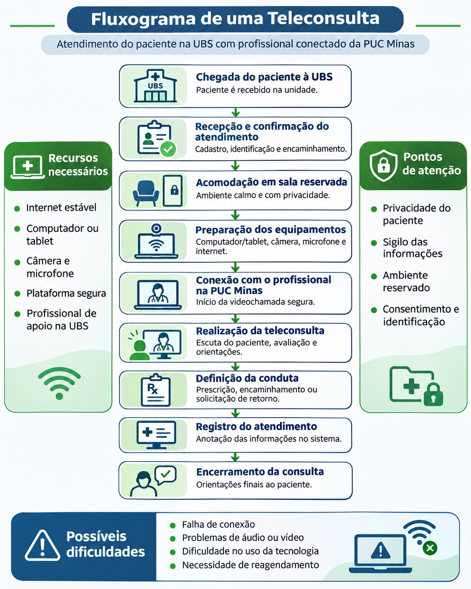

# Sprint 1

**1) Revisar a proposta dos ambientes com o professor/profissional da área de Arquitetura:**

Discutido com a professora de Arquitetura as principais mudanças, tudo na parte 4.

**2)Analisar os recursos tecnológicos necessários:**

Deixado para proxima etapa.

**3) Representar como poderia funcionar uma teleconsulta:**

### Funcionamento de uma teleconsulta entre a UBS e a PUC Minas

O atendimento começa com a chegada do paciente à Unidade Básica de Saúde (UBS), onde a recepção confirma o agendamento e os dados cadastrais. Em seguida, o paciente é levado a uma sala reservada, e um funcionário da UBS prepara os equipamentos e verifica a conexão com a internet. Feito isso, é iniciada a videochamada com o profissional da PUC Minas, por meio de uma plataforma segura, com a confirmação da identidade dos participantes e o consentimento do paciente.

Durante a consulta, o profissional escuta o paciente, realiza a avaliação possível à distância e define a conduta: orientações, prescrições, exames, retorno ou encaminhamento para atendimento presencial, quando a teleconsulta não for suficiente. Por fim, as informações são registradas com segurança no sistema e a consulta é encerrada após confirmar que o paciente compreendeu as orientações.

### Recursos necessários

- *Computador ou tablet:* para realizar a videochamada.
- *Câmera e microfone:* para a comunicação por áudio e vídeo.
- *Conexão estável com a internet:* para evitar interrupções.
- *Plataforma segura de videochamada:* para proteger as informações compartilhadas.
- *Sala reservada:* para garantir conforto e privacidade ao paciente.
- *Profissional de apoio na UBS:* para preparar os equipamentos e auxiliar o paciente.
- *Sistema de registro:* para armazenar com segurança o histórico do atendimento.

### Pontos de atenção

- *Privacidade do paciente:* consulta em ambiente reservado, sem que outras pessoas escutem.
- *Sigilo das informações:* proteção dos dados pessoais e médicos, conforme a LGPD.
- *Identificação dos participantes:* confirmar a identidade do paciente e do profissional antes de iniciar.
- *Consentimento do paciente:* o paciente deve ser informado e concordar com o atendimento remoto.
- *Funcionamento dos equipamentos:* verificar câmera, microfone, computador e internet antes da consulta.
- *Qualidade da comunicação:* garantir que o paciente compreenda as orientações.
- *Limitações do atendimento remoto:* reconhecer quando é necessário atendimento presencial.

### Possíveis dificuldades durante o atendimento

- *Problemas na chegada e identificação:* dados incorretos ou agendamento não confirmado; a recepção deve corrigir antes do atendimento.
- *Indisponibilidade de sala reservada:* compromete a privacidade; organizar outro ambiente ou aguardar.
- *Falha na conexão com a internet:* tentar restabelecer a conexão ou reagendar.
- *Problemas com câmera ou microfone:* verificar as configurações e os equipamentos.
- *Dificuldade no uso da tecnologia:* um funcionário da UBS pode auxiliar o paciente.
- *Problemas de comunicação:* o profissional deve falar com clareza e confirmar o entendimento do paciente.
- *Limitações na avaliação médica:* encaminhar para atendimento presencial quando necessário.
- *Problemas no registro das informações:* seguir os procedimentos de contingência da unidade, mantendo o sigilo.
- *Necessidade de reagendamento:* organizar novo horário ou outra forma adequada de atendimento.

**4) Revisar as representações dos ambientes:**

Após nova conversa com a professora de Arquitetura, ela sugeriu as seguintes alterações:

1- Incluir um scanner ou impressora na escrivaninha, para digitalizar exames trazidos pelos pacientes e as recomendações médicas.

2- Reduzir a distância entre a poltrona e a parede, que atualmente é de 1,50 m.

Link antigo gerado pelo Claude.ai:

https://claude.ai/artifact/YVfdSLz1m8xGVBubeoo8JW

Link atualizado gerado pelo Claude.ai:

https://claude.ai/artifact/YVfdSLz1m8xGVBubeoo8JW
